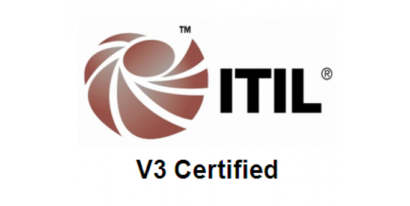

---
# You don't need to edit this file, it's empty on purpose.
# Edit theme's home layout instead if you wanna make some changes
# See: https://jekyllrb.com/docs/themes/#overriding-theme-defaults
layout: home
author_profile: false
title: " "
footer:
  links:
    - label: ""
#      image: "assets/images/compyld_tn.jpg"
      icon: "fac fa-4x fa-list-old-stylex"
      url: "https://compyld.io"
    - label: ""
      icon: "fab fa-4x fa-github"
      url: "https://github.com/BalazsGyarmati"
    - label: ""
      icon: "fab fa-4x fa-linkedin"
      url: "https://hu.linkedin.com/in/gyarmatibalazs/hu"
    - label: ""
      icon: "fab fa-4x fa-twitter-square"
      url: "https://twitter.com/BalazsGyarmati"
---
 
# Balazs Gyarmati
## DevOps Engineer

